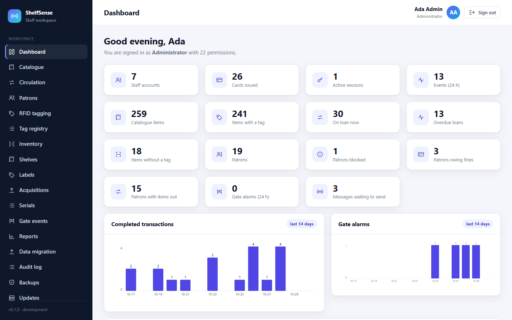
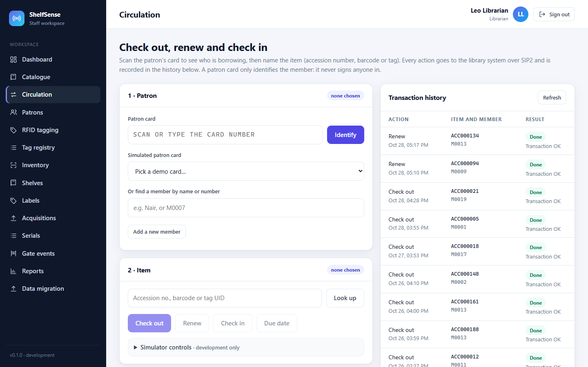
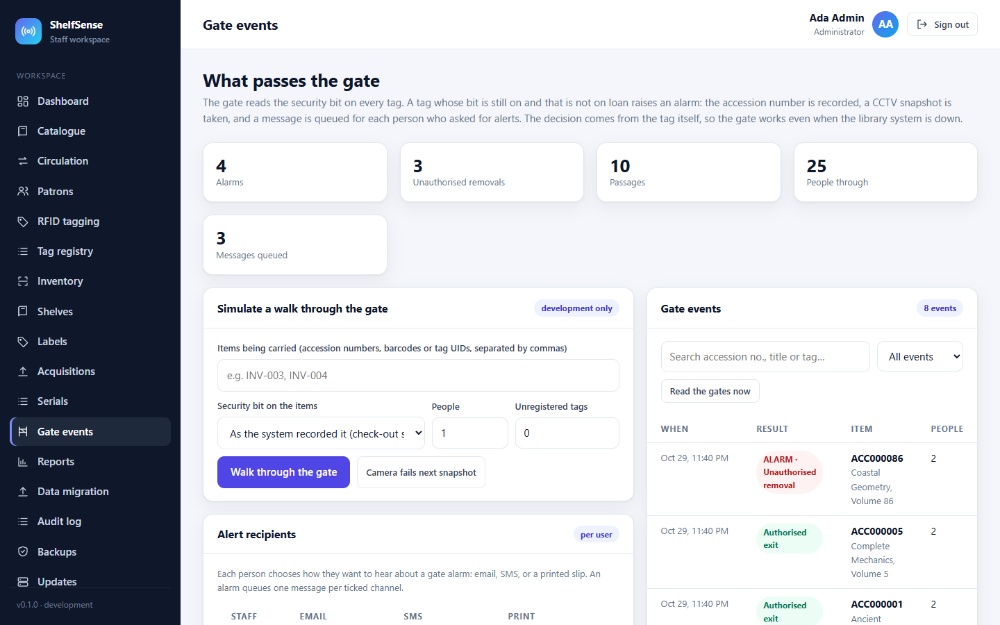
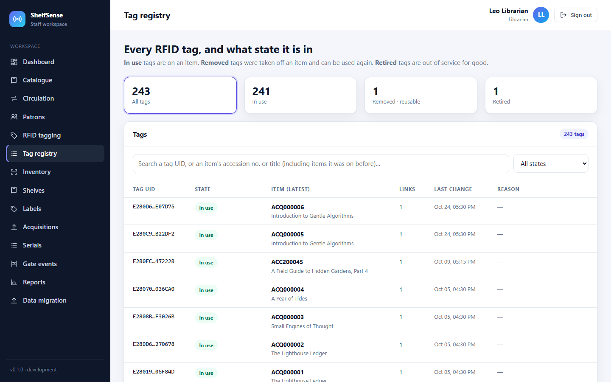
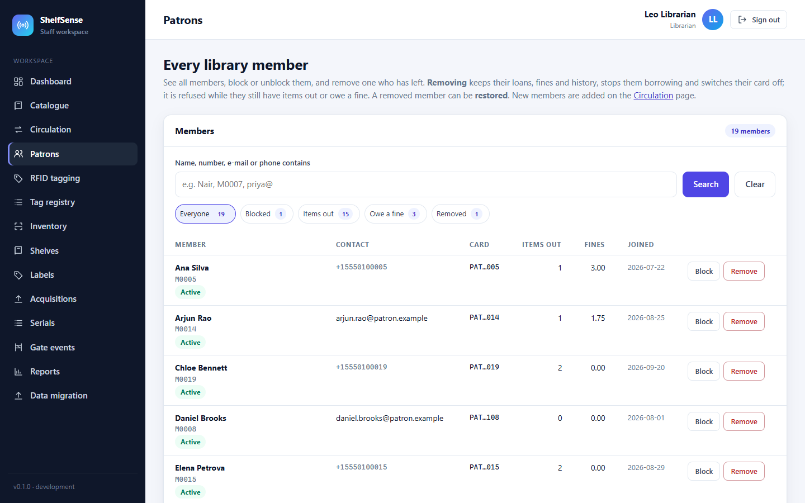
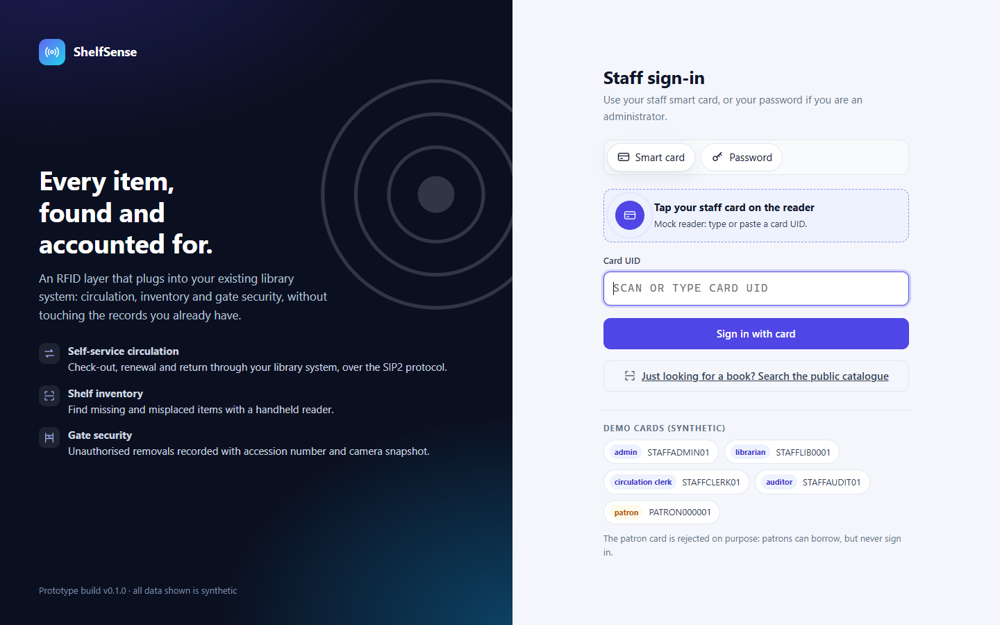
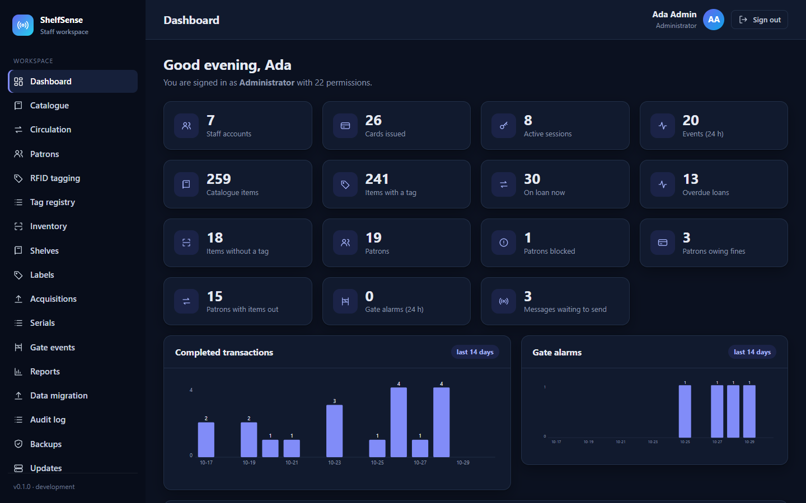
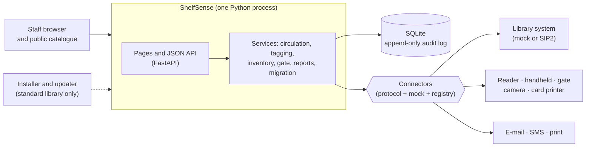

# ShelfSense

[](https://github.com/VighneshHM/shelfsense/actions/workflows/ci.yml)


[](LICENSE)

**RFID for the library system a library already runs.** ShelfSense is an add-on that sits beside an existing integrated
library management system (ILMS): staff tag books, lend and return them at the desk, sweep shelves with a handheld reader,
and a security gate raises an alarm with a camera snapshot when a book leaves without being checked out. It talks to the
library system over the **SIP2** protocol, so the library keeps its catalogue and rules.

Every device and outside service sits behind an interface with a built-in simulator, so the whole system runs, and is
tested, without any hardware.



## Highlights

- **Integration by interface.** Reader, handheld, gate, camera, card printer, e-mail, SMS and the library system are each a
  Python protocol with a mock, chosen by a name in the config. The **SIP2** client (codec, timeouts, retries with the same
  transaction id, a simulator with failure injection) makes sure a timeout never lends a book twice.
- **Data you can trust.** A staged 20,000-row spreadsheet import with review, reconciliation and rollback (13 s to validate,
  7 s to commit); an audit log and loan history kept append-only by database triggers; verified backups with a restore drill.
- **Security.** Role-based permissions on every route, hashed session tokens, account lockout, patron privacy (archive and
  erase), a public-catalogue kiosk mode, and signed, verified update packages.
- **Offline delivery.** An Ed25519-signed package installs, updates (backup, rehearsal on a copy, then switch) and rolls back
  with no internet, proven by an automated run with the network blocked.
- **Quality.** 864 automated tests, each tagged with the requirement it proves; ruff, mypy and a dependency audit in CI on
  Windows and Linux.

**Stack:** Python 3.12+, FastAPI, SQLAlchemy 2 and Alembic on SQLite (WAL, FTS5 full-text search), Jinja2 server-rendered
pages with plain JavaScript, pytest, GitHub Actions, Docker.

## Quick start

### With Docker (one command)

```bash
docker build -t shelfsense .
docker run --rm -p 8000:8000 shelfsense
```

Open **http://localhost:8000** after about 20 seconds (the first start loads the demo library).

### From source

You need **Python 3.12 or newer** and Git.

```bash
git clone https://github.com/VighneshHM/shelfsense.git
cd shelfsense
python -m venv .venv
```

| Step | Linux or macOS | Windows (PowerShell) |
|---|---|---|
| Install | `.venv/bin/pip install --require-hashes -r requirements.lock -r requirements-dev.lock`<br>`.venv/bin/pip install -e . --no-deps --no-build-isolation` | `.\.venv\Scripts\pip install --require-hashes -r requirements.lock -r requirements-dev.lock`<br>`.\.venv\Scripts\pip install -e . --no-deps --no-build-isolation` |
| Load the demo library | `.venv/bin/shelfsense seed-demo` | `.\.venv\Scripts\shelfsense seed-demo` |
| Start | `.venv/bin/shelfsense run` | `.\.venv\Scripts\shelfsense run` |

Then open **http://127.0.0.1:8000** (API docs at `/docs`). `seed-demo --reset` starts again from a clean demo.

### Signing in

The sign-in page offers one simulated staff card per role:

| Card | Role | Good for |
|---|---|---|
| `STAFFLIB0001` | Librarian | catalogue, circulation, tagging, inventory, data migration |
| `STAFFADMIN01` | Administrator | everything, plus staff, roles, Settings, gate, backups, audit log |
| `STAFFCLERK01` | Circulation clerk | the desk: check-out, renew, check-in, patrons |
| `STAFFAUDIT01` | Auditor | read-only: reports, audit log, gate |

The demo library holds 259 books (241 tagged), 20 patrons in different situations, 7 staff and about a hundred days of
activity, so every page has something in it. All data is synthetic. A patron card (`PATRON000001`) is refused at sign-in
by design.

[**Feature tour →**](docs/feature-tour.md) walks through every area step by step.

## Screenshots

| | |
|---|---|
|  |  |
| **Circulation:** check-out, renew and return through the library system | **Security gate:** alarms with accession number and snapshot |
|  |  |
| **Tag registry:** every RFID tag and its state | **Patrons:** filters, block, remove and erase |
|  |  |
| **Sign-in** with a staff card or password | **Dark mode** follows the system setting |

## Architecture



- **One process, one database file.** Simple to run at a single library; WAL mode for concurrent readers; versioned Alembic
  migrations that only move forward.
- **Connectors at the edge.** The application never imports a vendor SDK. A real reader or a new library system is one class
  plus a line in `config/config.toml`.
- **Check-out goes to the library system first**, then the loan is recorded in one transaction. Retries reuse the transaction
  id, and the SIP2 adapter asks the library system before resending, so a lost reply cannot lend a book twice.
- **The gate decides from the tag's own security bit**, so it keeps working when the library system is down.

Full design: [`docs/architecture.md`](docs/architecture.md). Every design decision with its alternatives:
[`docs/decisions.md`](docs/decisions.md).

## Installing at a library

A library receives a signed package (`shelfsense-<version>.zip`), a licence file and the vendor's public key. No internet is
needed on the server:

```bash
python install.py --root /opt/shelfsense --licence licence.json --trusted-key vendor.pub
python /opt/shelfsense/manage.py create-admin --username site.admin --name "Site Admin"
python /opt/shelfsense/manage.py run
```

Updates (`manage.py update`), rollback (`manage.py rollback --yes`), recovery, the environment checklist, configuration,
TLS and running as a service are in [`docs/deployment.md`](docs/deployment.md).

## Development

The same checks as CI:

```bash
python -m ruff format --check .      # formatting
python -m ruff check .               # lint and static analysis, including the Bandit security rules
python -m mypy                       # type check
python -m pytest -n auto             # 864 tests in parallel, on real migrated databases
python scripts/lifecycle_demo.py     # real offline install, update and rollback with the network blocked
```

Dependencies are pinned with hashes in `requirements.lock` (runtime, shipped) and `requirements-dev.lock` (development
and build tools). Some documents are generated, and a test fails when one is stale: `scripts/trace.py` (requirement
traceability), `scripts/gen_docs.py` (data dictionary and API reference), `scripts/sbom_lock.py` (SBOM and licence
inventory) and `scripts/sample_reports.py` (sample import reports).

<details>
<summary>Project layout</summary>

```
src/shelfsense/
  app.py, routes.py, deps.py      web app factory, sign-in and system API, auth and permission dependencies
  *_routes.py, pages.py           HTTP API per area, and the staff pages
  auth/                           password hashing, sign-in service, permission catalogue and built-in roles
  catalogue/, labels/, shelves/   items, full-text search, barcodes and spine labels, shelves and the virtual bookshelf
  acquisitions/, serials/         purchase orders and receiving, subscriptions and issues
  circulation/                    loans, fines, members; the library-system connector (mock, and sip2/: client, codec, simulator)
  rfid/                           device interfaces, mocks, registry, tagging
  inventory/, gate/               shelf sweeps; gate events, footfall and camera
  notifications/, reports/        message queue, providers, reminders; reports and the dashboard
  migration/, backup.py           spreadsheet import with staging and rollback; verified backup and restore
  integrations/                   smart-card credential provider and network cataloguing (mocks)
  settings_admin.py, doctor.py    the Settings page rules; the environment and configuration check
  models.py, db.py, migrations/   ORM, engine, versioned migrations
  audit.py, logging_setup.py      append-only audit trail, masked structured logs
  web/                            templates and static files (no external requests)
src/shelfsense_lifecycle/         offline packages: signing, licence, install, update, rollback, SBOM
scripts/                          release, lifecycle demo, document generators, performance report
docs/                             documentation (docs/index.md maps it)
tests/                            pytest suite, tagged with requirement IDs
```

</details>

## Documentation

| | |
|---|---|
| [Feature tour](docs/feature-tour.md) | every area, step by step, with the demo library |
| [Architecture](docs/architecture.md) and [decisions](docs/decisions.md) | layers, components, data, interfaces, security, trade-offs |
| [Deployment](docs/deployment.md) | offline install, update, rollback, configuration, TLS, service |
| [User guide](docs/user-guide.md) and [administration](docs/administration.md) | desk tasks; staff, roles, Settings, backups |
| [SIP2 connector](docs/sip2.md) | the protocol client, simulator and limits |
| [Test plan](docs/test-plan.md), [performance](docs/performance-results.md), [security checks](docs/security-checks.md) | how it is verified |
| [Requirements traceability](docs/traceability.md) | every requirement against the tests that prove it |
| [Index of all documents](docs/index.md) | everything else |

## Status and limits

A complete, tested prototype, not a deployed product. The reader, gate, camera, card printer, message providers and the
library system are simulated. The SIP2 client has been tested against its own simulator, written from the protocol
specification, not against a vendor system; NCIP is not implemented. What a live site would still need is listed in
[`docs/remaining-work.md`](docs/remaining-work.md).

Built by [Vighnesh Haresh Madani](https://github.com/VighneshHM), with an AI pair-programming assistant; every design was
reviewed and approved before it was built ([`docs/decisions.md`](docs/decisions.md)).

## Licence and contributing

ShelfSense is **source-available**: you are welcome to read the code and to contribute, but any other use (running it for a
library, copying it into another project, or redistributing it) needs the author's permission first. See
[`LICENSE`](LICENSE) and [`CONTRIBUTING.md`](CONTRIBUTING.md).
