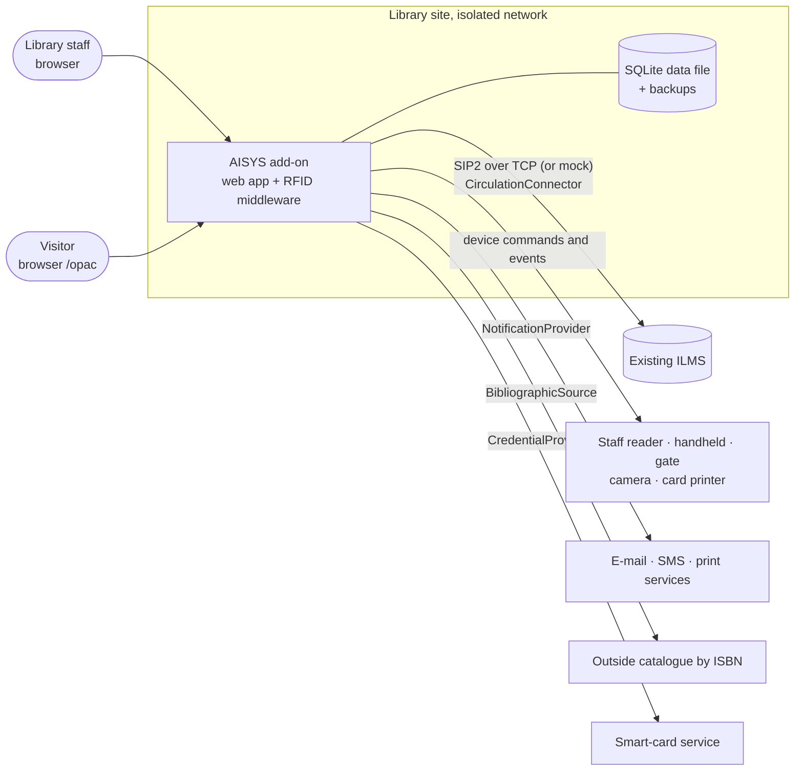
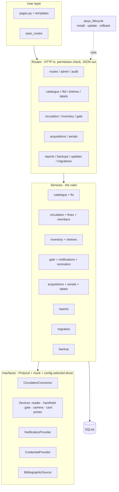
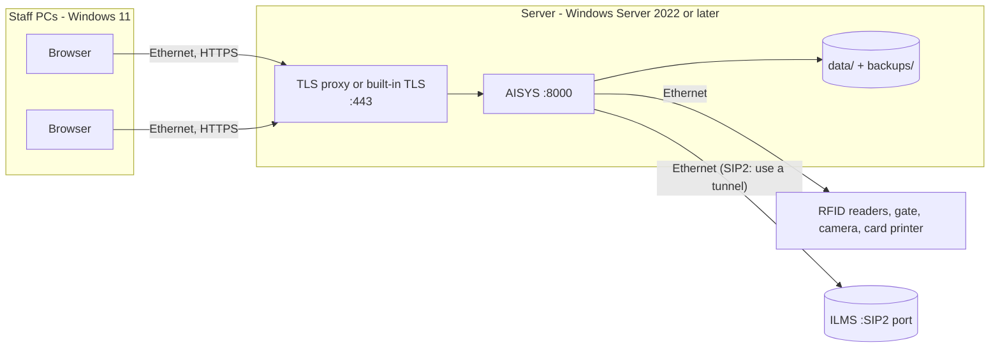
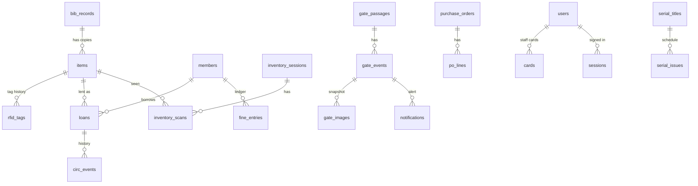
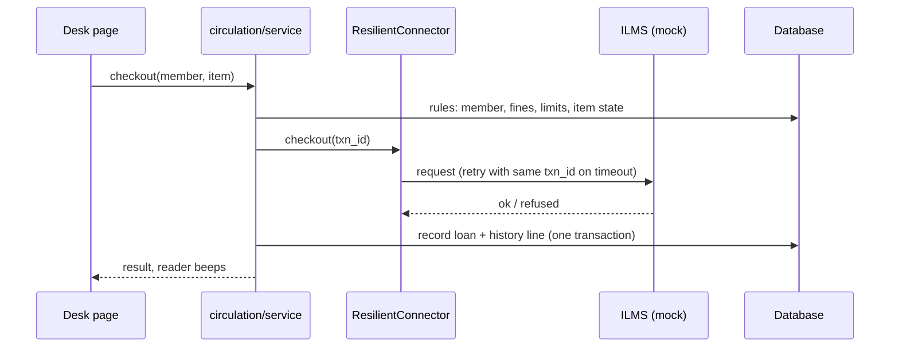

# Architecture package (D2)

Sections: 1 context, 2 layers, 3 components, 4 deployment, 5 database, 6 interfaces, 7 event model and key flows,
8 security design, 9 decisions and alternatives. The code walk-through is `docs/walkthrough.md`; tables and endpoints are in the
generated `docs/data-dictionary.md` and `docs/api-reference.md`.

## 1. Context

Everything outside the dashed site boundary is **mocked** in this delivery behind an interface (SOP section 3). The add-on never
writes the ILMS's records: all ILMS access goes through the connector.

## 2. Layers (SOP section 6)

| Layer | Responsibility | Where it lives |
|---|---|---|
| User layer | Staff web interface, public catalogue (OPAC), dashboard, reports, administration | `web/templates`, `web/static`, `pages.py`, `opac_routes.py` |
| Application layer | Cataloguing, circulation, members, fines, inventory, shelves, acquisitions, serials, labels, notification, reporting, access control | `catalogue/`, `circulation/`, `inventory/`, `shelves/`, `acquisitions/`, `serials/`, `labels/`, `notifications/`, `reports/`, `auth/` |
| RFID middleware | Device-neutral commands and events for staff reader, handheld, gate, smart card, printer and camera | `rfid/devices.py` (Protocols), `rfid/registry.py`, `rfid/mock.py`, `rfid/events.py` |
| Interoperability | ILMS adapter boundary, a mock, and a SIP2 client (`docs/sip2.md`); no NCIP | `circulation/connector.py`, `mock_ilms.py`, `resilience.py`, `registry.py`, `sip2/` |
| Data layer | Transactional database, search index, audit log, migration staging, backup and restore | `models.py`, `migrations/`, `catalogue/fts.py`, `audit.py`, `migration/`, `backup.py` |
| Integration layer | E-mail, SMS, print, CCTV photo, ILMS, net-cataloguing connectors | `notifications/providers.py`, `integrations/`, `rfid/mock.py` (camera) |
| Operations layer | Configuration, secrets, offline installer, logs, health checks, updates, backups, rollback | `config.py`, `logging_setup.py`, `doctor.py`, `aisys_lifecycle/`, `backup.py` |

Dependencies point downward only: routes call services; services call the data layer and the interfaces; nothing in the
application layer imports a vendor SDK or a mock directly (mocks are chosen by configuration).

## 3. Components

Each unit has one purpose and talks to others through a small interface; `aisys_lifecycle` is standard-library only so it works
before anything is installed and when a release is broken.

## 4. Deployment

**Topology (one library site, isolated network).**

**Installation layout** (folder created by `install.py`; see `docs/deployment.md`): `releases/<version>/venv` (one environment per
version), `state.json` (current and previous), `config/` (config, secret, licence, trusted key), `data/` (database and backups),
`incoming/` (update packages), `tools/`, `manage.py`.

**Network and interface details.** Values marked *site* are filled in during installation; none is hard-coded.

| Interface | Direction | Protocol / transport | Default / config key | Notes |
|---|---|---|---|---|
| Staff and public browsers | in | HTTPS (or HTTP behind a proxy) | `[app] host`, `port` = 127.0.0.1:8000; `[server] tls_certfile`, `tls_keyfile` | Bind to the LAN address only when TLS is on |
| ILMS | out | SIP2 over TCP (no encryption: VPN, stunnel or TLS proxy) | `[ilms] driver`, `endpoint` (*site*), `port` (*site*), `login`, `institution`, `location`, `timeout_s`, `checksum`, `retries`, `backoff_s`; password from `AISYS_ILMS_PASSWORD` only | `mock` by default; `sip2` tested against a simulator only; NCIP would be one more class (`register_driver`) |
| Staff reader, handheld, gate, camera, card printer | out | Vendor SDK or TCP/serial, per driver | `[[devices]] id, kind, driver` + driver options (*site*) | Mock here |
| Mail, SMS, print | out | SMTP / gateway API / print queue, per driver | `[notifications] email, sms, print` drivers | Mock here |
| Outside catalogue | out | Per driver (Z39.50, SRU, HTTP API) | `[netcat] driver` | Mock here |
| Database | local | SQLite file, WAL | `[database] url` / `AISYS_DATABASE_URL` | One writer at a time |
| Backups | local | Files + JSON manifests | `[backup] dir` | Copy off the machine regularly |

Offline: the whole system installs and updates from a signed package with no internet (`docs/deployment.md`).

## 5. Database

SQLite in WAL mode through SQLAlchemy 2; versioned migrations `0001` to `0011` (Alembic, shipped inside the package) create it.
30 tables (see `docs/data-dictionary.md` for every column and the full diagram). Core relationships:

Rules the database itself enforces (so a bug in code cannot break them): one active tag per item and per tag number (partial
unique indexes); one open loan per item; a card is staff **or** patron, never both; the audit log, circulation events, fine ledger
and gate events are append-only (triggers refuse UPDATE and DELETE); one reminder per loan, kind, channel and due date; status
columns are restricted to their allowed values (check constraints).

**Search index.** `item_fts` is an SQLite FTS5 table with one row per item, kept current by triggers on every insert, edit and
delete, so a new item is searchable at once (real-time indexing). It is derived data: excluded from the integrity fingerprint and
rebuilt by the migration.

**Migration staging area.** Imported rows go to `migration_rows` verbatim with their validation result before any catalogue record
is created; a batch commit inserts in one transaction and can be rolled back by batch.

**Backup and restore.** SQLite's online backup API into a single verified file + manifest (label, time, schema revision, SHA-256,
row counts); a per-table SHA-256 fingerprint is the proof that data is intact (`docs/backup-restore.md`).

## 6. Interfaces

All are `typing.Protocol`s with a mock and a registry; a real implementation is a class plus a config line.

| Interface | Methods (summary) | Mock | Failure behaviour |
|---|---|---|---|
| `CirculationConnector` | `patron_status`, `checkout`, `renew`, `checkin`, `due_date` | `MockIlms` (answers in SIP2 wording); `Sip2Connector` (SIP2 over TCP, simulator in `sip2/server.py`) | `ResilientConnector`: bounded retries with the same transaction id; timeouts surface as "try again", never a half-recorded loan; the SIP2 connector also verifies with the ILMS before repeating a request whose answer was lost |
| `StaffReader` | `read_field`, `encode`, `set_security`, `clear`, `indicate` | `MockStaffReader` (simulated pad) | write device first, database second, undo the device if the save fails |
| `Handheld` | `scan`, `indicate` | `MockHandheld` (loads a shelf from the catalogue) | each tag earns a beep and a light |
| `Gate` | `poll` (passages: tags seen, people count), `indicate` | `MockGate` | alarm decided from the security bit only |
| `Camera` | `capture(caption)` | `MockCamera` (labelled SVG frame) | a failed capture is recorded on the event, the alarm still stands |
| `CardPrinter` | `personalise(CardJob)` | `MockCardPrinter` | jam or offline reported and recorded |
| `NotificationProvider` | `send(Outgoing)` per channel | `MockEmail/Sms/PrintProvider` (outbox, failure injection) | queued first, retried with back-off, marked failed after the limit |
| `CredentialProvider` | `verify(CardPresentation)` | `MockCredentialProvider` | patron cards never reach a login |
| `BibliographicSource` | `lookup(isbn)` | `MockNetCatalogue` (synthetic records) | outage: "enter it by hand" |

## 7. Event model and key flows

Four streams, deliberately separate: **audit events** (what staff did, append-only), **circulation events** (the loan history,
append-only), **tag events** (device and tag activity), **gate events** (alarms with accession number, image and alert status).
Notifications are rows in a queue.

**Check-out (ILMS first, local commit second):**

**Gate alarm:** gate reads tags → look up each tag's security bit locally → write the gate event (+ footfall) → capture a camera
snapshot → queue alerts per staff preference → a loop or a button delivers them with retries.

**Patron reminder:** a loop scans open loans due tomorrow or today → one queued message per loan, kind, channel and due date
(unique index) → the same delivery step; a returned or renewed loan's reminder is cancelled at delivery.

## 8. Security design

| Concern | Design |
|---|---|
| Authentication | Staff card through a credential provider (or password for the demo administrator, scrypt-hashed); session token random, stored hashed, expires; lockout after repeated failures; patron card can never sign in |
| Authorisation | Role-based permissions (`docs/data-dictionary.md`, matrix); every route declares its permission; 403 is audited; deactivating a person ends their sessions at once |
| Data protection | Synthetic data only; card numbers masked in the audit log and logs; contact details never written to the audit log; the public catalogue exposes no personal or internal data |
| Input handling | Pydantic bodies; the catalogue's validator for hand entry and import; plain-name file rules (no path traversal); parameterised SQL; `LIKE` wildcards escaped; full-text input never reaches FTS5 as syntax; CSV formulas neutralised; header-injection characters stripped from message subjects |
| Transport | HTTPS directly (`[server] tls_*`, tested with a real handshake) or behind a TLS proxy; `Secure`/`HttpOnly`/`SameSite=Lax` cookies in production; HSTS, `nosniff`, `X-Frame-Options: DENY`, `Referrer-Policy` on every response |
| Secrets | From the environment or `config/secret.key` (generated at install); production refuses a key shorter than 32 characters; nothing secret in the repository |
| Integrity | Backups verified when made and before restore; fingerprint proof; maintenance mode during a restore; signed update packages (Ed25519) with a checksum per file |
| Auditability | Every sign-in, denial and change recorded with who, what, when and from where; the log is append-only by database trigger |
| Abuse limits | Login lockout; 60 public searches a minute per address; bounded page sizes everywhere |

Known gaps are listed in `docs/security-checks.md` (no content-security-policy because pages use inline scripts; no penetration
test; the credential provider is a mock).

## 9. Decisions and alternatives

| Decision | Why | Alternatives considered | Cost |
|---|---|---|---|
| Add-on with connector, not an ILMS replacement | The SOP asks to integrate with an existing ILMS without changing its records | Build a full ILMS | FR01 acquisition and serials are a reference implementation, not an ILMS |
| Python, FastAPI, server-rendered pages | Small, readable, works offline, no build chain | SPA front end; Java or .NET | Less interactive pages |
| SQLite + SQLAlchemy + Alembic | Zero-install database for an isolated site; versioned migrations; FTS5 built in | PostgreSQL | One writer at a time |
| Protocol + mock + registry for everything external | Required by the SOP; real hardware is a class and a config line | Hard-wired mocks | Mocks prove the interface, not a vendor |
| Database-enforced invariants | Bugs cannot corrupt core rules | Application checks only | SQLite-specific syntax |
| FTS5 index maintained by triggers | Real-time indexing without a separate service | External search engine (Elasticsearch, Whoosh) | Index lives in the same file |
| Ed25519-signed packages, pure-Python verification | Trust checkable before anything is installed | Checksums only | A small verifier of my own, tested against RFC 8032 |
| Loop inside the app for reminders and delivery | An installed copy needs no extra scheduler | OS scheduler only | A thread in the web process |
