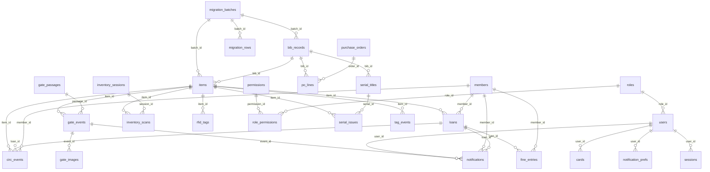

# Data dictionary

_Generated by `python scripts/gen_docs.py` from the SQLAlchemy models. Do not edit by hand._

30 tables. Times are stored with a UTC offset. Every table has an integer `id` primary key unless noted.
The full-text search index `item_fts` (SQLite FTS5, migration 0010) is derived data kept current by triggers and is not listed.

## Entity-relationship diagram

## Roles and permissions

Each person has one role; a role is a set of permissions, and every endpoint names the permission it needs.

| Permission | What it allows | admin | librarian | circulation_clerk | auditor |
|---|---|---|---|---|---|
| `catalogue.read` | Search and view catalogue records | yes | yes | yes |  |
| `catalogue.write` | Create and edit catalogue records | yes | yes |  |  |
| `member.read` | View members | yes | yes | yes |  |
| `member.write` | Create and edit members | yes | yes |  |  |
| `member.remove` | Remove and restore members | yes | yes |  |  |
| `member.erase` | Erase a removed member's personal details | yes |  |  |  |
| `circulation.checkout` | Check items out | yes | yes | yes |  |
| `circulation.checkin` | Check items in | yes | yes | yes |  |
| `circulation.renew` | Renew loans | yes | yes | yes |  |
| `circulation.override` | Override circulation blocks | yes | yes |  |  |
| `rfid.tag` | Tag and re-tag items | yes | yes |  |  |
| `inventory.run` | Run inventory and shelf-reading sessions | yes | yes |  |  |
| `gate.view` | View gate events | yes | yes |  | yes |
| `reports.view` | View dashboards and reports | yes | yes |  | yes |
| `audit.read` | Read the audit log | yes |  |  | yes |
| `migration.run` | Run data migrations | yes | yes |  |  |
| `acquisitions.manage` | Create and receive purchase orders | yes | yes |  |  |
| `serials.manage` | Manage serial subscriptions and receive issues | yes | yes |  |  |
| `shelves.manage` | Manage shelves and print labels | yes | yes |  |  |
| `admin.users` | Manage staff users and cards | yes |  |  |  |
| `admin.config` | View/change configuration | yes |  |  |  |
| `system.view` | View system health and versions | yes | yes |  | yes |

- **admin**: System administrator
- **librarian**: Librarian
- **circulation_clerk**: Circulation desk clerk
- **auditor**: Read-only auditor

## `app_settings`

A library rule an administrator changed on the Settings page. It overrides the same value in the TOML file.

| Column | Type | Required | Notes |
|---|---|---|---|
| `key` | text(80) | yes | primary key |
| `value` | text(40) | yes |  |
| `updated_by` | text(64) | yes | default `` |
| `updated_at` | datetime | yes |  |

## `audit_events`

Append-only (enforced by DB triggers, see migration 0001).

| Column | Type | Required | Notes |
|---|---|---|---|
| `id` | integer | yes | primary key |
| `ts` | datetime | yes |  |
| `actor` | text(64) | yes |  |
| `action` | text(64) | yes |  |
| `entity` | text(64) | yes | default `` |
| `entity_id` | text(64) | yes | default `` |
| `outcome` | text(10) | yes | default `success` |
| `detail` | JSON | yes |  |
| `ip` | text(64) | yes | default `` |

Indexes: index `ix_audit_events_action` on (action); index `ix_audit_events_actor` on (actor); index `ix_audit_events_ts` on (ts).

## `bib_records`

| Column | Type | Required | Notes |
|---|---|---|---|
| `id` | integer | yes | primary key |
| `dedupe_key` | text(400) | yes | unique |
| `title` | text(500) | yes |  |
| `author` | text(300) | yes | default `` |
| `isbn` | text(13) | no |  |
| `publisher` | text(300) | yes | default `` |
| `pub_year` | integer | no |  |
| `edition` | text(100) | yes | default `` |
| `language` | text(50) | yes | default `` |
| `batch_id` | integer | no | → `migration_batches.id` |
| `created_at` | datetime | yes |  |

Indexes: index `ix_bib_records_batch_id` on (batch_id); index `ix_bib_records_isbn` on (isbn); index `ix_bib_records_title` on (title).

## `cards`

A smart card. kind='staff' may log in; kind='patron' only identifies a member.

| Column | Type | Required | Notes |
|---|---|---|---|
| `id` | integer | yes | primary key |
| `uid` | text(64) | yes | unique |
| `kind` | text(10) | yes |  |
| `user_id` | integer | no | → `users.id` |
| `member_ref` | text(64) | no |  |
| `active` | yes/no | yes | default `True` |
| `issued_at` | datetime | yes |  |

## `circ_events`

Auditable transaction history: every circulation attempt, including refusals and ILMS failures. Append-only (DB triggers, migration 0005). `txn_id` is the id sent to the ILMS, so a local row can be matched to the ILMS's own log.

| Column | Type | Required | Notes |
|---|---|---|---|
| `id` | integer | yes | primary key |
| `ts` | datetime | yes |  |
| `action` | text(16) | yes |  |
| `outcome` | text(10) | yes |  |
| `code` | text(32) | yes | default `` |
| `message` | text(300) | yes | default `` |
| `protocol` | text(10) | yes | default `` |
| `txn_id` | text(40) | yes |  |
| `member_id` | integer | no | → `members.id` |
| `item_id` | integer | no | → `items.id` |
| `loan_id` | integer | no | → `loans.id` |
| `actor` | text(64) | yes | default `` |
| `detail` | JSON | yes |  |

Indexes: index `ix_circ_events_action` on (action); index `ix_circ_events_item_id` on (item_id); index `ix_circ_events_member_id` on (member_id); index `ix_circ_events_ts` on (ts); index `ix_circ_events_txn_id` on (txn_id).

## `fine_entries`

Fine ledger, append-only (DB triggers, migration 0007). Balance = opening + charges - payments - waivers.

| Column | Type | Required | Notes |
|---|---|---|---|
| `id` | integer | yes | primary key |
| `ts` | datetime | yes |  |
| `member_id` | integer | yes | → `members.id` |
| `loan_id` | integer | no | → `loans.id` |
| `kind` | text(10) | yes |  |
| `amount_cents` | integer | yes |  |
| `note` | text(300) | yes | default `` |
| `actor` | text(64) | yes | default `` |
| `detail` | JSON | yes |  |

Indexes: index `ix_fine_entries_member_id` on (member_id); index `ix_fine_entries_ts` on (ts).

## `gate_events`

One tag seen at a gate and what we made of it (append-only, DB triggers, migration 0008). kind: unauthorised security bit on, the item is not on loan: someone is taking it out (ALARM) armed_on_loan security bit on although the item is on loan: a check-out that could not switch it off (ALARM) unissued a tag that belongs to no item (ALARM if its bit is on) authorised bit off and the item is on loan: a normal exit bit_off bit off but the item is not on loan: it was switched off without a loan (warning) The alarm is decided from the security bit read at the gate, never from the library system.

| Column | Type | Required | Notes |
|---|---|---|---|
| `id` | integer | yes | primary key |
| `ts` | datetime | yes |  |
| `passage_id` | integer | yes | → `gate_passages.id` |
| `gate_id` | text(64) | yes |  |
| `kind` | text(20) | yes |  |
| `alarm` | yes/no | yes |  |
| `tag_uid` | text(32) | yes |  |
| `item_id` | integer | no | → `items.id` |
| `accession_no` | text(32) | yes | default `` |
| `title` | text(500) | yes | default `` |
| `loan_member_no` | text(32) | yes | default `` |
| `security_armed` | yes/no | no |  |
| `on_loan` | yes/no | yes | default `False` |
| `people` | integer | yes | default `1` |
| `decided_by` | text(20) | yes | default `security_bit` |
| `duplicate_of` | integer | no |  |
| `camera_id` | text(64) | yes | default `` |
| `image_error` | text(200) | yes | default `` |
| `note` | text(300) | yes | default `` |

Indexes: index `ix_gate_events_gate_id` on (gate_id); index `ix_gate_events_item_id` on (item_id); index `ix_gate_events_kind` on (kind); index `ix_gate_events_passage_id` on (passage_id); index `ix_gate_events_tag_uid` on (tag_uid); index `ix_gate_events_ts` on (ts).

## `gate_images`

The CCTV snapshot taken for an alarm (append-only).

| Column | Type | Required | Notes |
|---|---|---|---|
| `id` | integer | yes | primary key |
| `event_id` | integer | yes | unique; → `gate_events.id` |
| `ts` | datetime | yes |  |
| `camera_id` | text(64) | yes | default `` |
| `content_type` | text(40) | yes |  |
| `data` | BLOB | yes |  |

## `gate_passages`

One walk through a gate (append-only). Footfall is the sum of `people`.

| Column | Type | Required | Notes |
|---|---|---|---|
| `id` | integer | yes | primary key |
| `ts` | datetime | yes |  |
| `gate_id` | text(64) | yes |  |
| `people` | integer | yes | default `1` |

Indexes: index `ix_gate_passages_ts` on (ts).

## `inventory_scans`

A distinct tag seen in a session, how it was classified, and the beep/flash it earned.

| Column | Type | Required | Notes |
|---|---|---|---|
| `id` | integer | yes | primary key |
| `session_id` | integer | yes | → `inventory_sessions.id` |
| `tag_uid` | text(32) | yes |  |
| `item_id` | integer | no | → `items.id` |
| `result` | text(16) | yes |  |
| `signal` | text(8) | yes |  |
| `home_location` | text(100) | yes | default `` |
| `note` | text(200) | yes | default `` |
| `reads` | integer | yes | default `1` |
| `first_seen` | datetime | yes |  |
| `last_seen` | datetime | yes |  |

Indexes: index `ix_inventory_scans_session_id` on (session_id); unique index `uq_inventory_scans_session_tag` on (session_id, tag_uid).

## `inventory_sessions`

One shelf-reading run: a location, a handheld, and the tags it has seen so far.

| Column | Type | Required | Notes |
|---|---|---|---|
| `id` | integer | yes | primary key |
| `location` | text(100) | yes |  |
| `handheld_id` | text(64) | yes |  |
| `status` | text(10) | yes | default `open` |
| `started_by` | text(64) | yes |  |
| `started_at` | datetime | yes |  |
| `closed_by` | text(64) | yes | default `` |
| `closed_at` | datetime | no |  |
| `sweeps` | integer | yes | default `0` |
| `summary` | JSON | yes |  |

Indexes: index `ix_inventory_sessions_location` on (location).

## `items`

A physical copy. Existing items are never updated by migration; only inserted.

| Column | Type | Required | Notes |
|---|---|---|---|
| `id` | integer | yes | primary key |
| `bib_id` | integer | yes | → `bib_records.id` |
| `accession_no` | text(32) | yes | unique |
| `barcode` | text(64) | no | unique |
| `call_number` | text(100) | yes | default `` |
| `location` | text(100) | yes | default `` |
| `item_type` | text(16) | yes | default `book` |
| `status` | text(16) | yes | default `available` |
| `is_reference` | yes/no | yes | default `False` |
| `price` | NUMERIC(10, 2) | no |  |
| `acquired_on` | DATE | no |  |
| `batch_id` | integer | no | → `migration_batches.id` |
| `created_at` | datetime | yes |  |

Indexes: index `ix_items_batch_id` on (batch_id); index `ix_items_bib_id` on (bib_id).

## `loans`

One borrowing of one item. Open while returned_at is empty; an item has at most one open loan (DB-enforced).

| Column | Type | Required | Notes |
|---|---|---|---|
| `id` | integer | yes | primary key |
| `member_id` | integer | yes | → `members.id` |
| `item_id` | integer | yes | → `items.id` |
| `out_at` | datetime | yes |  |
| `due_at` | datetime | yes |  |
| `renewals` | integer | yes | default `0` |
| `returned_at` | datetime | no |  |
| `out_by` | text(64) | yes |  |
| `returned_by` | text(64) | yes | default `` |

Indexes: index `ix_loans_item_id` on (item_id); index `ix_loans_member_id` on (member_id); unique index `uq_loans_open_item` on (item_id) where `returned_at IS NULL`.

## `members`

A library member. Patrons are identified by their card but are never users: they cannot log in.

| Column | Type | Required | Notes |
|---|---|---|---|
| `id` | integer | yes | primary key |
| `member_no` | text(32) | yes | unique |
| `name` | text(200) | yes |  |
| `status` | text(10) | yes | default `active` |
| `block_reason` | text(200) | yes | default `` |
| `fines_cents` | integer | yes | default `0` |
| `email` | text(200) | yes | default `` |
| `phone` | text(32) | yes | default `` |
| `reminders_on` | yes/no | yes | default `True` |
| `created_at` | datetime | yes |  |
| `removed_at` | datetime | no |  |
| `removed_by` | text(64) | yes | default `` |
| `removed_reason` | text(200) | yes | default `` |
| `status_before_removal` | text(10) | yes | default `` |
| `erased_at` | datetime | no |  |

Indexes: index `ix_members_name` on (name).

## `migration_batches`

One uploaded spreadsheet. Moves staged -> validated -> committed -> rolled_back (or failed).

| Column | Type | Required | Notes |
|---|---|---|---|
| `id` | integer | yes | primary key |
| `filename` | text(255) | yes |  |
| `file_sha256` | text(64) | yes |  |
| `status` | text(16) | yes | default `staged` |
| `mapping` | JSON | yes |  |
| `headers` | JSON | yes |  |
| `summary` | JSON | yes |  |
| `backup_path` | text(500) | no |  |
| `created_by` | text(64) | yes |  |
| `created_at` | datetime | yes |  |
| `committed_at` | datetime | no |  |
| `rolled_back_at` | datetime | no |  |

Indexes: index `ix_migration_batches_file_sha256` on (file_sha256).

## `migration_rows`

Staging area: every source row is kept verbatim, with its validation outcome.

| Column | Type | Required | Notes |
|---|---|---|---|
| `id` | integer | yes | primary key |
| `batch_id` | integer | yes | → `migration_batches.id` |
| `row_no` | integer | yes |  |
| `raw` | JSON | yes |  |
| `mapped` | JSON | yes |  |
| `status` | text(10) | yes | default `staged` |
| `errors` | JSON | yes |  |
| `duplicate_of` | text(80) | yes | default `` |

Indexes: index `ix_migration_rows_batch_id` on (batch_id).

## `notification_prefs`

Which channels a staff user wants alerts on, and where to reach them (email address, phone, printer).

| Column | Type | Required | Notes |
|---|---|---|---|
| `id` | integer | yes | primary key |
| `user_id` | integer | yes | → `users.id` |
| `channel` | text(10) | yes |  |
| `address` | text(200) | yes |  |
| `active` | yes/no | yes | default `True` |

Indexes: unique index `uq_notification_prefs_user_channel` on (user_id, channel).

## `notifications`

A message waiting to go out (or already sent / given up on). Delivery is a separate step with retries.

| Column | Type | Required | Notes |
|---|---|---|---|
| `id` | integer | yes | primary key |
| `created_at` | datetime | yes |  |
| `channel` | text(10) | yes |  |
| `user_id` | integer | no | → `users.id` |
| `recipient` | text(200) | yes |  |
| `subject` | text(200) | yes |  |
| `body` | TEXT | yes |  |
| `status` | text(10) | yes | default `queued` |
| `attempts` | integer | yes | default `0` |
| `last_error` | text(300) | yes | default `` |
| `next_attempt_at` | datetime | yes |  |
| `sent_at` | datetime | no |  |
| `provider_ref` | text(100) | yes | default `` |
| `event_id` | integer | no | → `gate_events.id` |
| `kind` | text(20) | yes | default `` |
| `member_id` | integer | no | → `members.id` (not enforced by the database) |
| `loan_id` | integer | no | → `loans.id` (not enforced by the database) |
| `due_on` | text(10) | yes | default `` |

Indexes: index `ix_notifications_event_id` on (event_id); index `ix_notifications_loan_id` on (loan_id); index `ix_notifications_member_id` on (member_id); index `ix_notifications_status` on (status); unique index `uq_notifications_reminder` on (loan_id, kind, channel, due_on) where `loan_id IS NOT NULL`.

## `permissions`

| Column | Type | Required | Notes |
|---|---|---|---|
| `id` | integer | yes | primary key |
| `code` | text(64) | yes | unique |
| `description` | text(200) | yes | default `` |

## `po_lines`

| Column | Type | Required | Notes |
|---|---|---|---|
| `id` | integer | yes | primary key |
| `order_id` | integer | yes | → `purchase_orders.id` |
| `title` | text(500) | yes |  |
| `author` | text(300) | yes | default `` |
| `isbn` | text(13) | no |  |
| `publisher` | text(300) | yes | default `` |
| `pub_year` | integer | no |  |
| `quantity` | integer | yes |  |
| `unit_price_cents` | integer | yes | default `0` |
| `location` | text(100) | yes | default `` |
| `received` | integer | yes | default `0` |
| `bib_id` | integer | no | → `bib_records.id` |

Indexes: index `ix_po_lines_order_id` on (order_id).

## `purchase_orders`

An order to a supplier. draft -> ordered -> part_received -> received (or cancelled).

| Column | Type | Required | Notes |
|---|---|---|---|
| `id` | integer | yes | primary key |
| `po_no` | text(32) | yes | unique |
| `supplier` | text(200) | yes |  |
| `status` | text(16) | yes | default `draft` |
| `note` | text(300) | yes | default `` |
| `created_by` | text(64) | yes |  |
| `created_at` | datetime | yes |  |
| `ordered_at` | datetime | no |  |
| `closed_at` | datetime | no |  |

## `rfid_tags`

One link between a physical tag and an item (one interval in the tag's life). status: 'active' = currently on the item 'removed' = taken off the item; the tag can be linked again (to any item) 'retired' = taken off and out of service for good (damaged / lost); the UID can never be linked again A tag UID has at most one active link and an item has at most one active tag (both enforced by the database).

| Column | Type | Required | Notes |
|---|---|---|---|
| `id` | integer | yes | primary key |
| `tag_uid` | text(32) | yes |  |
| `item_id` | integer | yes | → `items.id` |
| `status` | text(10) | yes | default `active` |
| `security_armed` | yes/no | yes | default `True` |
| `reader_id` | text(64) | yes | default `` |
| `tagged_by` | text(64) | yes |  |
| `tagged_at` | datetime | yes |  |
| `ended_at` | datetime | no |  |
| `end_reason` | text(200) | yes | default `` |

Indexes: index `ix_rfid_tags_item_id` on (item_id); index `ix_rfid_tags_tag_uid` on (tag_uid); unique index `uq_rfid_tags_active_item` on (item_id) where `status = 'active'`; unique index `uq_rfid_tags_active_uid` on (tag_uid) where `status = 'active'`.

## `role_permissions`

| Column | Type | Required | Notes |
|---|---|---|---|
| `role_id` | integer | yes | primary key; → `roles.id` |
| `permission_id` | integer | yes | primary key; → `permissions.id` |

## `roles`

| Column | Type | Required | Notes |
|---|---|---|---|
| `id` | integer | yes | primary key |
| `name` | text(64) | yes | unique |
| `description` | text(200) | yes | default `` |

## `serial_issues`

| Column | Type | Required | Notes |
|---|---|---|---|
| `id` | integer | yes | primary key |
| `serial_id` | integer | yes | → `serial_titles.id` |
| `label` | text(40) | yes |  |
| `expected_on` | DATE | yes |  |
| `received_on` | DATE | no |  |
| `status` | text(10) | yes | default `expected` |
| `item_id` | integer | no | → `items.id` |
| `note` | text(200) | yes | default `` |

Indexes: index `ix_serial_issues_status` on (status); unique index `uq_serial_issues_label` on (serial_id, label).

## `serial_titles`

A subscription: a journal or magazine that arrives on a schedule.

| Column | Type | Required | Notes |
|---|---|---|---|
| `id` | integer | yes | primary key |
| `title` | text(500) | yes |  |
| `issn` | text(9) | yes | default `` |
| `frequency` | text(12) | yes |  |
| `supplier` | text(200) | yes | default `` |
| `location` | text(100) | yes | default `` |
| `active` | yes/no | yes | default `True` |
| `bib_id` | integer | no | → `bib_records.id` |
| `created_at` | datetime | yes |  |

## `sessions`

| Column | Type | Required | Notes |
|---|---|---|---|
| `id` | integer | yes | primary key |
| `token_hash` | text(64) | yes | unique |
| `user_id` | integer | yes | → `users.id` |
| `method` | text(10) | yes |  |
| `created_at` | datetime | yes |  |
| `expires_at` | datetime | yes |  |
| `revoked` | yes/no | yes | default `False` |

## `shelves`

A shelf location the library manages. `code` equals the `location` text on its items.

| Column | Type | Required | Notes |
|---|---|---|---|
| `id` | integer | yes | primary key |
| `code` | text(100) | yes | unique |
| `description` | text(200) | yes | default `` |
| `capacity` | integer | no |  |
| `created_at` | datetime | yes |  |

## `tag_events`

Device/tag activity stream for monitoring (separate from the audit log, which records staff actions).

| Column | Type | Required | Notes |
|---|---|---|---|
| `id` | integer | yes | primary key |
| `ts` | datetime | yes |  |
| `tag_uid` | text(32) | yes |  |
| `reader_id` | text(64) | yes | default `` |
| `event_type` | text(20) | yes |  |
| `item_id` | integer | no | → `items.id` |
| `actor` | text(64) | yes | default `` |
| `detail` | JSON | yes |  |

Indexes: index `ix_tag_events_event_type` on (event_type); index `ix_tag_events_tag_uid` on (tag_uid); index `ix_tag_events_ts` on (ts).

## `users`

A staff account. Patrons are NOT users: they cannot authenticate.

| Column | Type | Required | Notes |
|---|---|---|---|
| `id` | integer | yes | primary key |
| `username` | text(64) | yes | unique |
| `display_name` | text(120) | yes |  |
| `password_hash` | text(300) | no |  |
| `role_id` | integer | yes | → `roles.id` |
| `active` | yes/no | yes | default `True` |
| `failed_logins` | integer | yes | default `0` |
| `locked_until` | datetime | no |  |
| `created_at` | datetime | yes |  |
