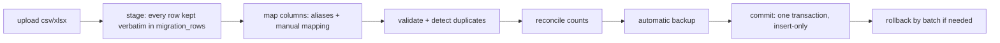
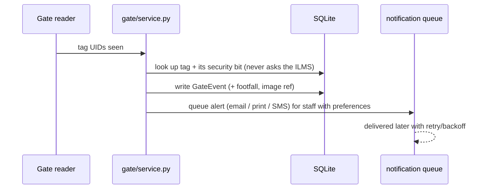
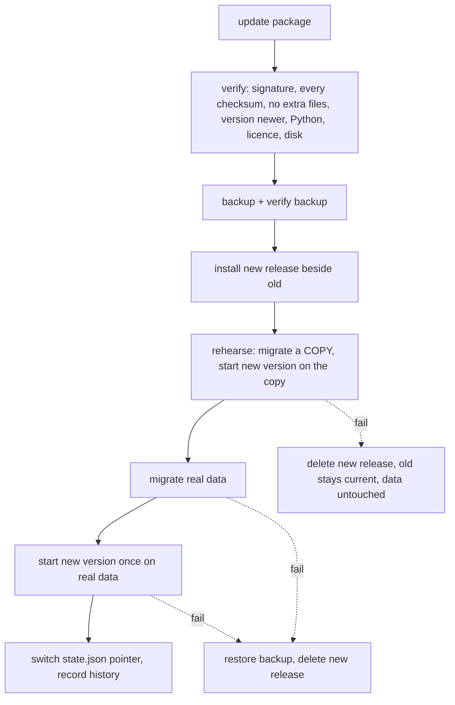

# AISYS RFID library add-on: final technical walkthrough

Everything below describes what is in the repository now. Where something is a simulation, a limit or not built, it says so
(sections 8, 10 and 12 are the honest ones). Detail per feature lives in the other files under `docs/`; this document is the map.

## 1. Requirements: what was asked, what was delivered

The SOP asks for an **RFID add-on that works with an existing library system (ILMS)** through connector interfaces, with
mocks for every device and service that is not available. It is an individual exercise, deadline 10 Oct 2026, judged by
ten acceptance scenarios (AC01 to AC10). All ten are implemented, tested and documented.

| AC | Scenario | Delivered | Where to look |
|---|---|---|---|
| AC01 | Import ~20,000 spreadsheet records | Staged import: map columns, validate, find duplicates, reconcile, commit in one transaction, roll back by batch, error CSV | `migration/`, `docs/migration.md` |
| AC02 | Tag a book | Tag lifecycle (active, removed, retired), one tag per item and one item per tag enforced by the database | `rfid/`, `catalogue/`, `docs/rfid.md` |
| AC03 | Check out / check in / renew through a mock ILMS | Connector boundary, retries with the same transaction id, idempotent mock; plus a SIP2 driver tested against a simulator | `circulation/`, `docs/circulation.md`, `docs/sip2.md` |
| AC04 | Circulation blocks | Blocked member, fines over the limit, loan limit, item status, renewal limits, each with a clear reason | `circulation/service.py`, `fines.py` |
| AC05 | Handheld inventory | Sessions per location: found, missing, unexpected, on loan, untagged; CSV export | `inventory/`, `docs/inventory.md` |
| AC06 | Security gate, CCTV, queued e-mail | Alarm decided from the tag's security bit only; unissued / armed-on-loan / bit-off events; footfall; camera snapshot; queued notifications with retry | `gate/`, `notifications/`, `docs/gate.md` |
| AC07 | Staff card login | Staff card = login; patron card = identifies a member only and can never log in | `auth/`, `integrations/credentials.py` |
| AC08 | Dashboard and reports | Reports with filters and CSV export, dashboard charts | `reports/`, `docs/reports.md` |
| AC09 | Offline install, update, rollback | Signed packages, install, update with rehearsal, rollback, recover, SBOM and licence inventory, Updates page | `aisys_lifecycle/`, `scripts/release.py`, `docs/deployment.md` |
| AC10 | Restore after a failed migration or integration change, proving the original data is intact | Verified backups, table-by-table fingerprint proof, guided restore with safety copy | `backup.py`, `docs/backup-restore.md` |

Beyond the scenarios: full-text search with a public catalogue (OPAC), shelves and a virtual bookshelf, acquisitions, serials, barcode and spine labels, net cataloguing by ISBN, patron card printing, patron loan reminders, member management and a fines ledger, role-based access, an append-only audit log with a searchable page, staff and card administration, health endpoints,
a requirements-to-tests traceability matrix (`docs/traceability.md`: 31 requirements), CI, and Dependabot.

**Required by the PDF** vs **my recommendation**: the ten scenarios, mocks for devices and services, synthetic data,
the staff-card/patron-card rule, ILMS integration through an interface, offline install/update/rollback, and the
backup-before-change rule were required. Choices such as SQLite, FastAPI, Ed25519 signing, the fines rule, the rehearsal
step and maintenance mode were mine (section 8).

## 2. Architecture

```mermaid
flowchart LR
  subgraph Browser
    UI[Server-rendered pages + small JS helpers]
  end
  subgraph App["aisys (FastAPI)"]
    PAGES[pages.py] --> SVC
    API[*_routes.py] --> SVC[Services: circulation, catalogue, inventory, gate, reports, migration, backup]
    SVC --> DB[(SQLite via SQLAlchemy)]
    SVC --> CONN[CirculationConnector]
    SVC --> DEV[DeviceRegistry]
    SVC --> NOTIF[NotificationProvider]
  end
  UI --> PAGES
  UI --> API
  CONN --> ILMS[Mock ILMS, or SIP2 over TCP to an ILMS / the simulator]
  DEV --> RF[Mock staff reader / handheld / gate / camera]
  NOTIF --> MAIL[Mock e-mail / SMS / print]
  subgraph Lifecycle["aisys_lifecycle (standard library only)"]
    INST[install / update / rollback / recover]
  end
  INST -. runs python -m aisys.cli .-> App
  INST --> BK[backup + restore]
```

**Layers and rules**
- **Routes** (`*_routes.py`) only translate HTTP to service calls and check permissions with `require("...")`.
- **Services** hold the business rules and know nothing about HTTP.
- **Boundaries** are Python `Protocol`s with a mock behind each: the ILMS (`circulation/connector.py`), RFID devices
  (`rfid/devices.py`), notification channels (`notifications/providers.py`), credential provider
  (`integrations/credentials.py`). Real hardware or a real ILMS means writing one class and naming it in config.
- **Config over code**: `config/config.sample.toml` builds the device list, ILMS driver, retries, fine rule, gate
  window and backup folder. Secrets come only from the environment (`AISYS_SECRET_KEY`).
- **The add-on never writes ILMS tables.** It keeps its own tables and talks to the ILMS through the connector.
  (A small reference catalogue exists only so the demo has books.)

## 3. Codebase map

```
src/aisys/
  app.py            create_app(): wiring, maintenance-mode middleware (503 during a restore)
  config.py         Settings from TOML + env (AISYS_CONFIG, AISYS_ENV, AISYS_DATABASE_URL, AISYS_PORT, ...)
  cli.py            aisys migrate | seed-demo | run | backup ... | notify-dispatch | version
  models.py         every table (23 models + one link table)
  migrate.py        programmatic Alembic; migrations/versions/0001-0008
  deps.py, auth/    sessions, RBAC (permissions.py), card/password login (service.py), hashing (security.py)
  audit.py          append-only audit writer
  catalogue/        item lookup, creation
  migration/        parsing.py, mapping.py, validation.py, service.py  (AC01)
  rfid/             devices.py (Protocols), mock.py, registry.py, events.py   (AC02, AC05, AC06)
  circulation/      connector.py, mock_ilms.py, resilience.py, service.py, fines.py, members.py, registry.py
  inventory/        service.py
  gate/             service.py, config.py
  notifications/    providers.py, queue.py, prefs.py, messages.py
  reports/          core.py, definitions.py, service.py
  backup.py         backups, fingerprint, compare, restore (AC10)
  admin_routes.py   Audit log search/export and staff/card administration (pages /audit and /admin)
  opac_routes.py    the public catalogue (no sign-in), shelves_routes.py, acquisitions_routes.py (+ serials), labels_routes.py
  catalogue/fts.py  full-text search (FTS5) helpers;  shelves/, acquisitions/, serials/, labels/ (Code 128)  services
  integrations/netcat.py   net cataloguing by ISBN (interface + mock);  doctor.py   `aisys doctor` environment check
  backup_routes.py, lifecycle_routes.py   HTTP for backups and the Updates page
  pages.py, web/    templates (Jinja) and static (app.css, ui.js), no CDN
  devtools/         drill.py, sample_data.py  (simulators, 404 in production)
src/aisys_lifecycle/   ed25519.py, bundle.py, licence.py, sbom.py, ops.py, __main__.py   (AC09)
scripts/            release.py (build/sign), lifecycle_demo.py, trace.py
tests/              27 test files, 782 test cases
scripts/            release.py, lifecycle_demo.py, trace.py, gen_docs.py (data dictionary + API reference), perf_report.py
docs/               one design doc per feature + requirements.csv + traceability.md
```

## 4. Code walkthrough: the important execution paths

### 4.1 Staff card login (AC07)
`POST /api/auth/card-login` -> `auth/service.login_with_card`. The card UID is looked up in `cards`; only `kind='staff'`
cards with a `user_id` can create a session (a database check constraint `ck_cards_owner` backs this up). The session token
is random; only its SHA-256 is stored (`sessions.token_hash`). Failed attempts lock the user after `max_failed_logins`.
A patron card presented here is refused and audited. Every sign-in and denial is written to `audit_events`.

### 4.2 Spreadsheet import (AC01)

`migration/service.py` stages (`MigrationBatch`, `MigrationRow`), `validation.py` produces per-row errors
(`{field, code, message}`), duplicates use `BibRecord.dedupe_key` and `Item.accession_no` uniqueness. Commit only inserts,
never updates existing items, and records `batch_id` on every row it creates so a batch can be rolled back exactly.
A 20,000-row file validates in about 13.1 s and commits in about 7.4 s on the development machine.

### 4.3 Tagging (AC02)
`POST /api/rfid/tagging`: the device write happens first (the reader encodes the tag), then the database insert; if the
insert fails the device write is undone (a reader cannot join a DB transaction). A tag ends as `removed` (reusable) or
`retired` (the UID can never be linked again). Two partial unique indexes make "one active tag per item and per UID" a
database rule, not a hope.

### 4.4 Circulation (AC03, AC04)
`circulation/service.py` checks the rules (member status, fines against the limit, max loans, item state, renewal limits),
then calls the connector. **ILMS first, local commit second**: if the ILMS refuses or is down after the bounded retries,
nothing local changes. `resilience.ResilientConnector` retries with the *same* transaction id so the idempotent mock cannot
double-count. `uq_loans_open_item` guarantees an item has at most one open loan. Overdue returns (and renewals of overdue
items) charge a fine into the append-only `fine_entries` ledger; circulation stops when the balance passes the limit.

### 4.5 Inventory (AC05)
A session is opened for a location. The handheld mock walks a shelf and posts scans; the service classifies each tag as
found, unexpected or misplaced, and at close lists missing items. Items on loan and untagged items are counted separately,
never called missing. Results export as CSV (formula-neutralised).

### 4.6 Gate (AC06)

Patron loan reminders reuse the same queue (`notifications/reminders.py`, `runner.py`): one message per loan, kind, channel and due date, enforced by a unique index, delivered by a loop that can run inside the app or as `notify-dispatch --every` (`docs/reminders.md`).

The alarm comes only from the tag's security bit, so the gate works while the ILMS is down. A repeat alarm for the same tag
inside a window (default 60 s) is recorded but not re-sent. Notifications are queued first and delivered by a button, the
API or `aisys notify-dispatch`; failures retry with back-off.

### 4.7 Reports (AC08)
`reports/definitions.py` declares each report (columns, filters); `reports/core.py` builds queries safely (parameterised,
`like()` escapes wildcards); `reports/service.py` runs them with paging and CSV export (leading `=`, `+`, `-`, `@`
neutralised). Dates are whole days in UTC. Stress-tested with 20,000 items and 15,000 events (10 to 360 ms per report).

### 4.8 Backup and restore (AC10)
- `create_backup`: SQLite online backup API into one self-contained file + a JSON manifest (label, time, schema revision,
  SHA-256, row counts), verified when made.
- `fingerprint`: per table, row count + SHA-256 over rows in a fixed order. `compare` shows each table as identical,
  different or one-sided; `sessions` and `audit_events` are "changed with use", not damage.
- `restore_backup`: verify the backup, take a **safety copy** of the current data, copy the backup in, integrity-check,
  re-fingerprint **every** table against the backup, **revert** if anything differs. During the restore the app answers
  everyone else with 503 + `Retry-After` (maintenance mode) so no concurrent write is lost. If the database stays busy
  more than 20 s the restore gives up with "nothing was changed".
- Backups are also taken automatically before every import and before every restore (and, in AC09, before every update).

### 4.9 Offline lifecycle (AC09)

`aisys_lifecycle/ops.py` implements `install`, `update`, `rollback`, `recover`, `prune`, `status`; `bundle.py` opens and
verifies packages; `ed25519.py` verifies signatures in pure Python so a first install needs only Python; `licence.py`
checks the signed licence; `sbom.py` builds the CycloneDX SBOM and licence table from the shipped wheels. Rollback restores
the pre-update backup only when the update changed the database layout; otherwise only the pointer moves.

## 5. Data

- **Sources:** a spreadsheet (`.csv` or `.xlsx`; samples of 200 and 20,000 rows in `samples/`, all synthetic), the mock
  readers/gate/handheld, the mock ILMS, and the user interface.
- **Storage:** one SQLite file (`data/aisys.db`, WAL mode). 30 tables plus the full-text index. Migrations `0001` to `0011` ship inside the package.
- **Lifecycle of important data:** import rows are staged then `migrated`; items are inserted only; tags have intervals
  (a re-tag creates a new row, history kept); loans stay forever (open while `returned_at` is null); the audit log,
  circulation events, fine ledger and gate events are append-only (database triggers reject UPDATE and DELETE).
- **Time:** stored with a UTC offset; reports use whole days in UTC.
- **Everything is synthetic.** No real names, cards or credentials anywhere. Demo identities live in `cli.py`.

## 6. Models

| Group | Tables |
|---|---|
| Identity and security | `users`, `roles`, `permissions`, `role_permissions`, `cards`, `sessions`, `audit_events` |
| Import | `migration_batches`, `migration_rows` |
| Catalogue | `bib_records`, `items` |
| RFID | `rfid_tags`, `tag_events` |
| Circulation | `members`, `loans`, `circ_events`, `fine_entries` |
| Inventory | `inventory_sessions`, `inventory_scans` |
| Gate and messages | `gate_passages`, `gate_events`, `gate_images`, `notification_prefs`, `notifications` |
| Shelves, acquisitions, serials | `shelves`, `purchase_orders`, `po_lines`, `serial_titles`, `serial_issues` (and the `item_fts` search index) |

Key relationships and rules: `Item` -> `BibRecord`; `RfidTag` -> `Item` (partial unique indexes on active rows);
`Loan` -> `Member` + `Item` (unique open loan per item); `Card` -> `User` (staff) or a member number (patron), with a
check constraint so a card cannot be both; `FineEntry` -> `Member` (the member's balance equals the ledger sum).
There are no AI or LLM models in this project.

## 7. APIs and integrations

About 130 endpoints (the list with the permission each needs is the generated `docs/api-reference.md`), all JSON, grouped by prefix: `/api/auth`, `/api/admin`, `/api/audit`, `/api/catalogue`, `/api/rfid`,
`/api/circulation`, `/api/inventory`, `/api/gate`, `/api/notifications`, `/api/reports`, `/api/migrations`, `/api/backups`,
`/api/updates`, plus `/health`, `/health/ready`, `/api/system/info`. The interactive OpenAPI page is served by FastAPI.
Every endpoint other than login and health needs a session and a named permission.

- **Mock-only endpoints** (`/mock/...`: place a tag on the reader, power a device, fail the ILMS, walk through the gate,
  disaster drill, fail the next import) exist only outside production and return 404 in production.
- **ILMS integration:** `CirculationConnector` (checkout, checkin, renew, patron status) with `ResilientConnector` on top.
  The default mock answers in SIP2 wording (it speaks no protocol). With `[ilms] driver = "sip2"` the **SIP2 protocol (3M 2.00) is spoken
  over TCP** (`circulation/sip2/`, `docs/sip2.md`), verified before any repeat so a lost answer never lends or renews twice.
  It was tested only against the simulator in the repository (`python -m aisys.cli sip2-sim`): **no certification is claimed and no
  vendor ILMS was used. NCIP 2.0 is not implemented.** SIP2 is unencrypted, so use a tunnel to the ILMS.
- **Devices:** `StaffReader`, `Handheld`, `Gate`, `Camera` Protocols; mock drivers; `register_driver(name, factory, kind)`.
- **Notifications:** `NotificationProvider` per channel (email, sms, print), all mocks that record what they would send.

## 8. Technical decisions

| Decision | Why | Alternatives | Cost / limit |
|---|---|---|---|
| Python + FastAPI, server-rendered Jinja pages, no front-end build, no CDN | Works offline, tiny deploy, easy to read | React SPA | Less interactive UI |
| SQLite (WAL) + SQLAlchemy + Alembic | Zero-install database for an isolated site; migrations are versioned | PostgreSQL | One writer at a time; fine for one site |
| Protocol + mock + config-driven registry for every device and service | Real hardware is a class plus a config line; required by the SOP | Hard-wired mocks | Mocks only prove the interface |
| Database enforces core rules (partial unique indexes, triggers, check constraints) | Bugs in code cannot corrupt the invariants | Application checks only | Needs SQLite-specific syntax |
| Device write first, then DB, with compensating undo | A reader cannot join a DB transaction | Two-phase commit | Rare double failure needs manual care |
| ILMS first, local commit second; retries reuse the transaction id | Never show a loan the ILMS refused; no double counting | Local first | A crash between the two is reconciled by retry |
| Gate decides from the tag's security bit only | Must work while the ILMS is down | Ask the ILMS | The cache of tag state must be kept current |
| Queue then deliver notifications | A mail outage must not block the gate | Send inline | Delivery is a separate step |
| Fingerprint (per-table SHA-256) as proof of integrity | "Prove the original data is intact" needs evidence | Row counts only | Reads every row (~3 s for 12 MB) |
| Restore = safety copy, verify, revert on mismatch, maintenance mode | A restore must never make things worse | Plain file copy | A few seconds of 503 |
| Ed25519-signed packages; pure-Python verification | Trust must be checkable before anything is installed | Checksums only | Slow (10 ms) and my own verifier code (tested against the RFC vector and a real library) |
| One release folder per version; pointer switched last; rehearse on a copy | The only irreversible step is the last; failures are cheap | In-place upgrade | Extra disk for one more environment |
| Rollback restores the backup only if the schema changed | Migrations only go forward | Write downgrade scripts | Post-update work goes to a safety copy |
| Update/rollback are command-line, the page only reads | They restart the server | A web button | Needs shell access |

## 9. Security and reliability

- **Authentication:** card login for staff (patron cards cannot log in, enforced in code and by a DB constraint), optional
  password for the demo admin (hashed). Session tokens are random and stored hashed; they expire; users lock after
  repeated failures.
- **Authorisation:** permission-based roles (admin, librarian, circulation clerk, auditor); every route declares its
  permission; pages show the friendly 403 page; navigation hides what you cannot use. Administration cannot lock the system out: you cannot deactivate or demote yourself, deactivating someone ends their open sessions at once, and every change is audited (`docs/administration.md`). Any request carrying a number too large for the database gets a clean 422.
- **Input handling:** pydantic models validate bodies; file names are limited to a plain-name pattern and resolved inside
  their folder (no path traversal for backups, packages, uploads); SQL is parameterised and `LIKE` wildcards are escaped;
  CSV exports neutralise formulas; HTML from notes is shown as text.
- **Audit:** every sensitive action is written to the append-only `audit_events` (triggers block edits).
- **Secrets:** only from the environment; production refuses to start without a 32-character `AISYS_SECRET_KEY`. The
  installer generates one. Dev-only simulators return 404 in production.
- **Failure behaviour:** bounded retries for the ILMS; notification retry with back-off; a restore waits at most 20 s for a
  busy database and then changes nothing; a failed import rolls back and keeps its backup; a failed update restores the data
  and keeps the old version; readiness (`/health/ready`) checks database and schema revision.
- **Logging:** structured JSON logs (`logging_setup.py`).
- **Supply chain:** versions pinned; CycloneDX SBOM and licence inventory per package; CI runs `pip-audit` (which found and
  forced the upgrade of `cryptography` during this work); Dependabot enabled.

## 10. Testing: what was done, the results, the gaps

- **782 automated test cases, all passing** (about 2.5 minutes on 4 parallel workers), `ruff` format and lint clean (including security rules), `mypy` type check clean, CI on
  Windows for Python 3.12 and 3.13, plus a dependency audit. Every test is tagged with the requirement it proves and
  `docs/traceability.md` is generated from those tags.
- **By area:** foundation/auth (test_foundation), import (test_migration, incl. the full 20,000-row run), tagging and tag
  lifecycle, circulation and fines and members, inventory, gate and notifications, reports, backup and restore (including
  busy-database, concurrent restores, hostile names and labels), lifecycle and Updates API, UI asset checks.
- **Beyond unit tests, for each feature I ran a bug hunt** (hostile inputs, concurrency, large data) and checked the real
  pages in a browser. Examples that found real bugs: restore without maintenance mode could lose concurrent work; a locked
  database hung a restore forever; one bad manifest broke the backup list; a deep Windows install folder crashed the
  installer; a `%` search matched everything; renewing an overdue item erased its fine.
- **Offline proof for AC09:** `scripts/lifecycle_demo.py` installs, updates and rolls back with the network
  blocked (every connection off the machine refused and logged; the log must stay empty), and the data is shown unchanged.
- **Gaps (honest):**
  - Nothing is tested against real hardware, a real ILMS, a real mail server or a real camera: they are mocks. The SIP2 client is
    tested against a simulator written from the specification, not against any vendor system.
  - Automated UI tests only check assets and pages render; interactive behaviour was verified by hand in the browser.
  - Load tests are limited to the sizes above on one machine; there is no multi-user soak test.
  - The lifecycle was exercised on Windows only. Linux is expected to work but is unverified.
  - Most AC09 unit tests use a fake release (no real virtual environment) for speed; the real path (real install, signed
    update, rollback, with the network blocked) runs in CI as the `lifecycle-demo` job (`scripts/lifecycle_demo.py`).

## 11. Deployment

- **Run from source (development):** `python -m pip install --require-hashes -r requirements.lock -r requirements-dev.lock`,
  `python -m pip install -e . --no-deps --no-build-isolation`, `python -m aisys.cli seed-demo`,
  `python -m aisys.cli run`, open http://127.0.0.1:8000. Demo staff cards and the admin password are in the README.
- **Offline installation (the delivered way):** build a signed package on a machine with internet once
  (`scripts/release.py`), copy the `.zip` and the vendor public key to the target, `python install.py --root <short folder>
  --licence licence.json --trusted-key vendor.pub`, then `python <root>/manage.py run`. Update and rollback commands are in
  `docs/deployment.md`.
- **Configuration:** `config/config.toml` (copy of the sample) for devices, ILMS driver, fine rule, gate, notifications,
  backup folder. Environment: `AISYS_CONFIG`, `AISYS_ENV` (`development` or `production`), `AISYS_DATABASE_URL`,
  `AISYS_BACKUP_DIR`, `AISYS_SECRET_KEY` (required in production), `AISYS_HOST`, `AISYS_PORT`.
- **Dependencies:** Python 3.12+, FastAPI, Uvicorn, SQLAlchemy, Alembic, Jinja2, python-multipart, openpyxl (runtime);
  pytest, httpx, ruff, cryptography (development only).
- **Infrastructure:** one process, one SQLite file, one backup folder. TLS is expected from a reverse proxy. Service wrappers, scheduled delivery of notifications and example proxy configuration are in `docs/deployment.md` (untested examples). Guides: `docs/user-guide.md`, `docs/troubleshooting.md`, `docs/remaining-work.md`.

## 12. Limitations and future improvements

The authoritative list, with the requirement each item belongs to, is `docs/remaining-work.md`. In short:

**Not built, by decision**
- SIP2 is built (a subset) but tested only against a simulator and not certified; NCIP 2.0 is not built (FR03 is marked done on
  that basis, see `docs/requirements.csv` and `docs/sip2.md`).
- No real RFID reader, gate, handheld, camera, card printer, SMS, e-mail or outside-catalogue driver: all are mocks behind interfaces.
- Acquisitions and serials are reference-level (orders, receiving, subscriptions, late issues); budgets, invoices, claim letters,
  holds and inter-library loan are not built. Fines are a simple configurable rule; a real ILMS would own them.
- Only staff are users. Patrons are reminded a day before and on the due day; overdue repeats and hold-ready notices are not built.
- SQLite only (backups and the search index use SQLite features).
- Administration has no password reset, role editor or permission editor; users are deactivated, never deleted.

**Needs a production environment**
- A site acceptance test with real staff and devices; a soak test on a server-class machine; the TLS proxy and service-wrapper
  examples run for real; Linux verification; a penetration test and a content-security-policy; automatic backup retention and an
  off-machine copy.

**Operational limits**
- A restore replaces everything, including the audit log up to the backup's moment; backups sit on the same machine unless copied away.
- An update needs the application stopped; the Windows install folder path must be short (about 150 characters).
- A first install trusts the key it is given; no key revocation; the licence has no hardware binding.

**Reasonable next steps**
1. A real driver for one reader family; a run of the SIP2 driver against the site's real ILMS (and an NCIP adapter if the site needs one).
2. A PostgreSQL option, with backup hooks for it.
3. Password reset (custom roles are built); overdue and hold-ready notices to patrons through the same queue.
4. A service wrapper tested on Windows Server; verify the lifecycle on Linux.
5. Automatic backup retention, an off-machine copy, monitoring of the health endpoints.
6. A browser-driven end-to-end suite and a multi-user soak test in CI.
